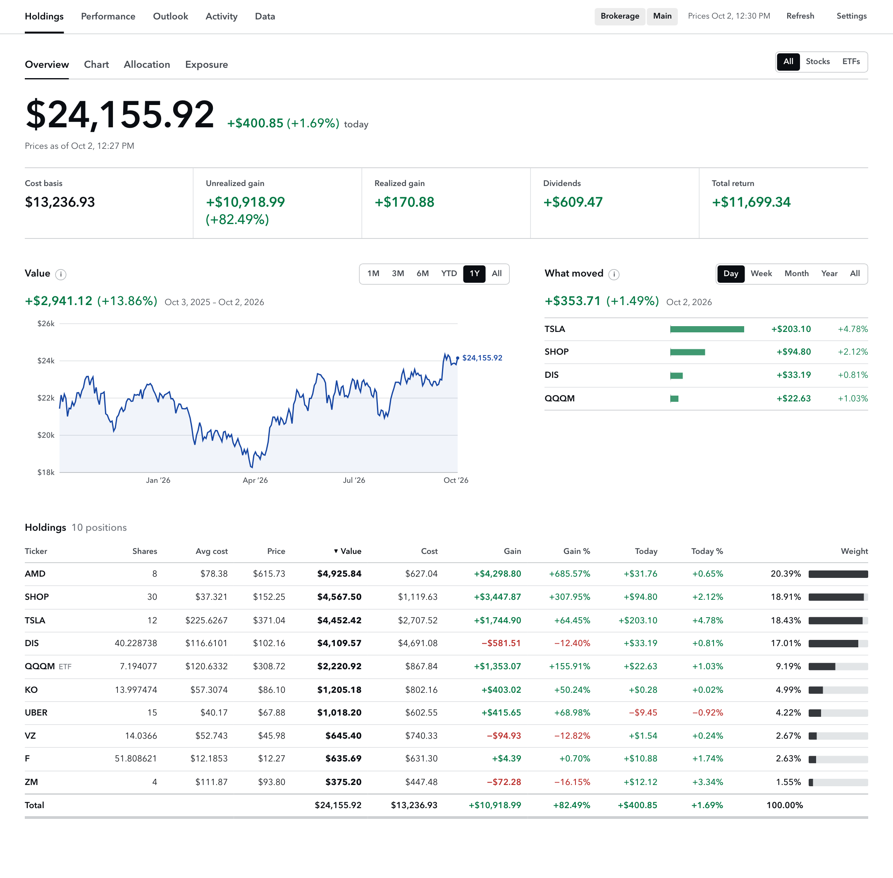
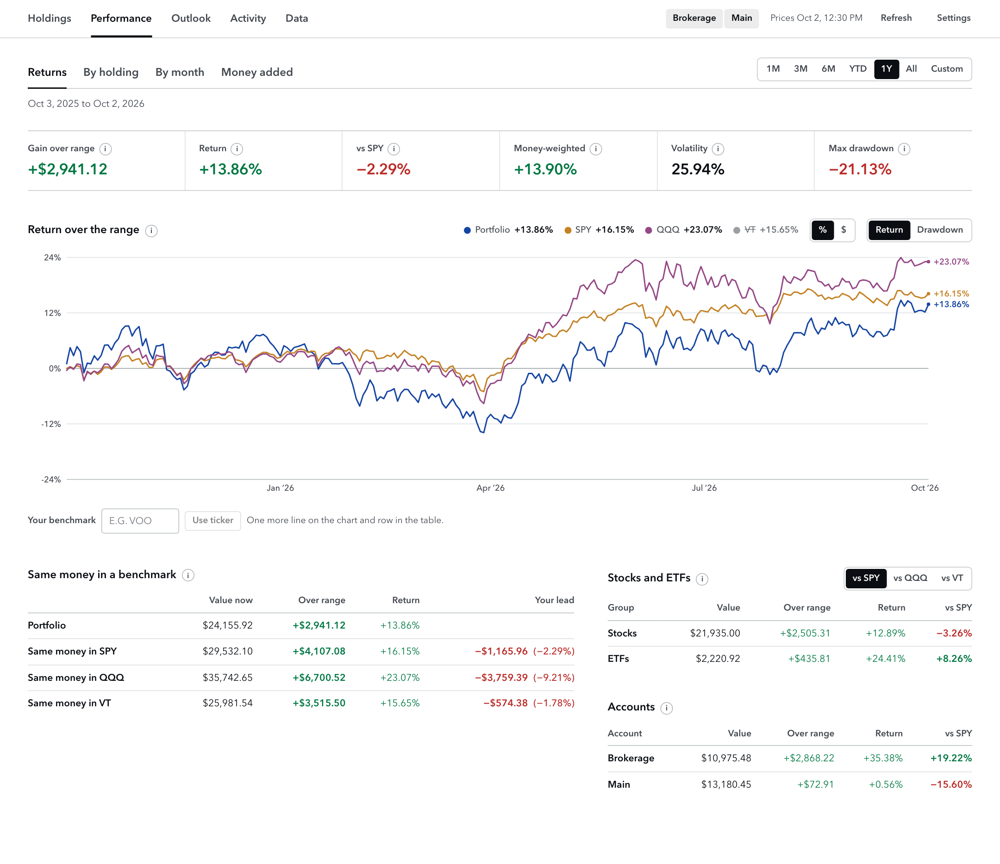
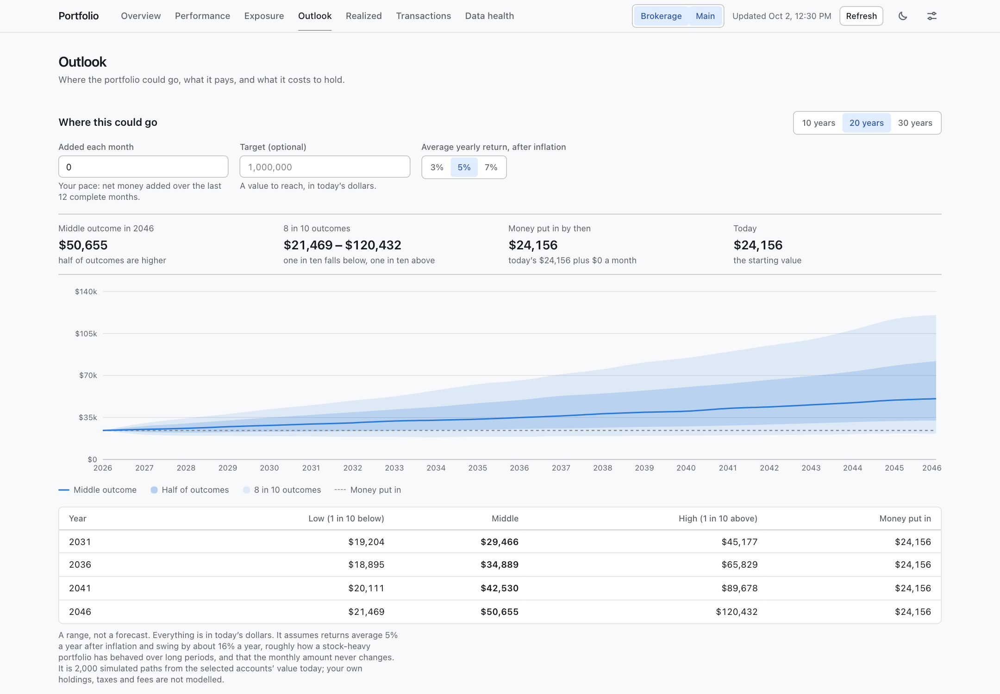
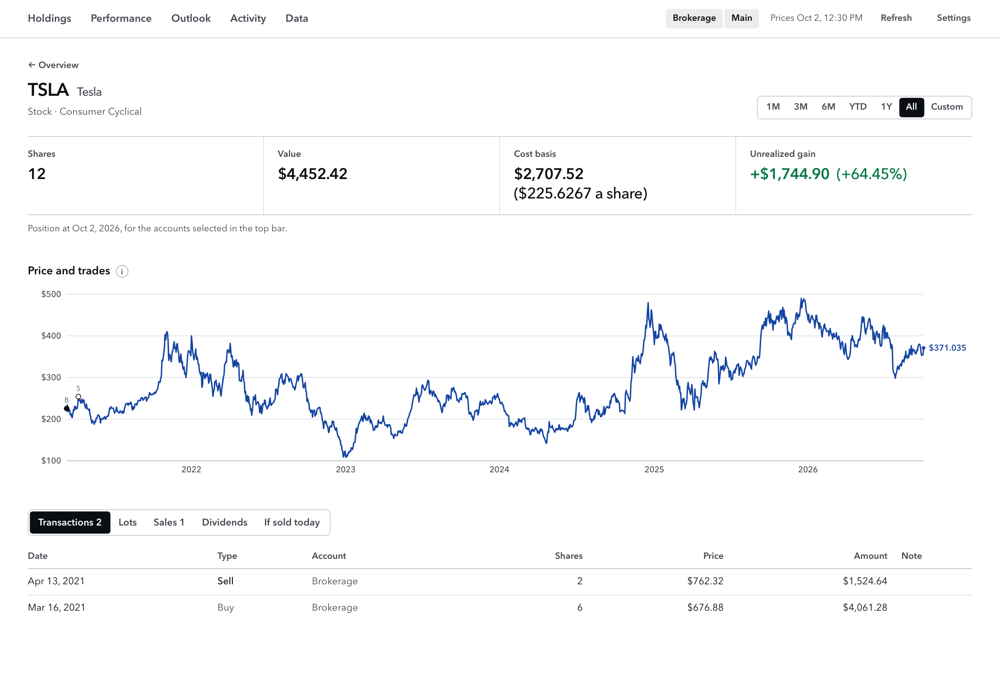

# Portfolio Tracker

A local, single-user replacement for the Google Sheets stock tracker. It keeps your transactions in a SQLite file, fetches prices and splits from Tiingo, and shows holdings, realized gains, true daily history, returns and allocation at `http://127.0.0.1:3000`.

Outbound requests send ticker symbols and date ranges to Tiingo, public fund identifiers to Vanguard for ETF holdings, and to Yahoo Finance the ticker of each stock without a sector and of each ETF you hold (for its sector breakdown and expense ratio). Portfolio amounts, share counts, and exposure calculations stay on your machine.



The screenshots here show the invented sample portfolio in `tests/fixtures/sample/`, running on the demo server described below.

## Run it

Requires Node 20 or newer.

```sh
npm install
npm start          # builds the client the first time, then serves http://127.0.0.1:3000
```

- **API key.** Copy `.env.example` to `.env` and put your free Tiingo key in it (`.env.local` wins if both exist):
  `TIINGO_API_KEY=your-key`. Both files are git-ignored. Without a key the app still works, but every holding is valued at cost and the Overview explains how to add one.
- **Data** lives in `data/portfolio.db` (git-ignored). Before every Replace-all import, and before any schema migration, a copy is saved to `data/backups/<timestamp>.db`. To start over, stop the server and delete `data/portfolio.db`.
- `npm run dev` runs the server and the Vite client with reload (open `http://127.0.0.1:5173`).
- `npm test` runs every test (no network). `npm run typecheck` runs TypeScript.
- **Commit guard.** `npm install` points git at the hooks in `.githooks/`. Before each commit they refuse `.env` files, anything in `local-notes/` or `data/`, databases and spreadsheets, any value from your `.env`, and any word listed in `local-notes/blocked-words.txt` (one per line; optional). `npx tsx scripts/commit-guard.ts --all` checks the whole tree.
- After pulling new code, delete `dist/` (or run `npm run build`) so `npm start` rebuilds the client.
- `npx tsx scripts/demo-server.ts` runs the app on port 3001 against the recorded Tiingo fixtures with the clock frozen at 2026-10-02 (its drop folder is `data/demo-inbox/`). It is useful for trying the UI without spending API requests.

### Sectors

Sectors and company names for stocks are looked up from Yahoo Finance in the background, one ticker at a time, whenever a traded stock has no sector. Only blank fields are filled; anything you type on **Data → Securities** is kept. A ticker Yahoo does not know (a delisted company, for instance) stays unassigned and is tried again the next time the server starts. Yahoo's endpoint is unofficial, so if it stops answering, set sectors by hand.

Each ETF you hold also gets a sector breakdown from Yahoo, refreshed weekly. The Overview's sector allocation spreads a fund's value across those sectors by default (**Funds: Split into sectors / One group**). Yahoo's sector weights cover only the stock part of a fund, so the rest goes to **Bonds** and **Cash and other**. A failed refresh keeps the last good breakdown; **Data → Health** lists any held fund whose breakdown is missing, failing or more than four weeks old. A fund with no breakdown stays under **ETFs**.

### Prices and the rate limit

Tiingo's free tier allows 50 requests an hour; the app stops at 45. Opening the Overview starts a background refresh when anything is stale: one request for live quotes, then one per ticker for daily history (benchmarks SPY and QQQ first, then tickers you hold, then tickers you have sold). A ticker you have sold is fetched once, through its last sale. With more than ~43 tickers ever traded, the first backfill spans more than an hour. The header shows how many are waiting and when fetching resumes, and history charts shade the incomplete days until then. Pages always render from the database and never wait on Tiingo.

## Import from the sheet

1. In Google Sheets, open the **Transactions** tab, select the whole table **including the header row**, and copy.
2. In the app, go to **Activity → Transactions → Import** and paste. (Or choose a CSV export of that tab.)
3. Check the preview. Every row must read cleanly; errors name the row number and the problem. Fix those in the sheet and paste again.
4. Choose **Replace all** (default; your current data is backed up first) or **Append**, and confirm.

Columns are matched by header name: `Ticker`, `Asset Type`, `Type`, `Shares`, `Split (n to 1)`, `Avg Price`, `Date`, `Account`, and an optional note column. Dates may be `M/D/YYYY` or `YYYY-MM-DD`; numbers may contain `$` and commas.

**Split rows are not applied.** Splits come from Tiingo. The sheet's split rows are kept aside and compared with Tiingo's on **Data → Health**. If Tiingo has no split within 5 trading days of one, an **Apply this split** button adds it by hand.

**Export CSV** (Activity → Transactions) writes the same columns, so an export can be re-imported (or pasted back into the sheet).

## Import from a broker

In **Activity → Transactions → Import**, choose a **Schwab JSON transaction export** or a **Robinhood account activity CSV**, enter the account it belongs to, and check the preview before pressing **Add**. Broker imports always append. Existing trades are matched by account, date, ticker, Buy/Sell, shares and price; repeated identical executions are matched one at a time, so re-importing a report adds only the missing occurrences.

Robinhood's [account activity report](https://robinhood.com/us/en/support/articles/reports-and-statements/) is supported, rather than its gains/losses report. The importer uses `Activity Date`, `Instrument`, `Trans Code`, `Quantity` and `Price`; it reads fractional shares, dollar prices and multiline descriptions. `Description` is also required to identify dividend reinvestments. Cash `Amount` is not used as the trade price.

Only ordinary stock/ETF buys and sells are imported. Dividend reinvestment buys are skipped because the app reinvests dividends itself. Cash dividends, deposits, withdrawals, lending payments, options and other transaction codes are listed under **Skipped rows**. Transfers of shares and corporate actions are not imported; splits still come from market data. A malformed trade blocks the whole save until it is fixed. New tickers with no explicit ETF description default to Stock and can be corrected on **Securities**.

Broker files are assumed to list newest trades first. Imports reverse same-day file order; the report has no execution timestamps. Check the preview and use the Transactions page's up/down controls if same-day trades need a different order.

Keep broker downloads in `local-notes/`, which is git-ignored, or anywhere outside the repository.

### Drop folder

Broker exports can skip the Import page. `npm start` creates `data/inbox/` (git-ignored, like the rest of `data/`; set `PORTFOLIO_INBOX` to use another folder). Inside it, make a folder named after an account and save that account's Schwab JSON or Robinhood activity CSV there, for example `data/inbox/Taxable/activity.csv`. The folder name is the account.

The app notices the file within a few seconds while it is running, or at the next start. It copies the database to `data/backups/`, adds the trades it does not already have (the same matching as the Import page, so dropping an overlapping or repeated export is safe), and moves the file to that account's `imported/` folder. A file with a malformed trade, a file that is not a broker export, or a file left outside an account folder is not imported at all: it stays where it is, and **Data → Drop folder** and a banner on the Overview say why until it is fixed or removed. The same section lists the last files handled. The sheet format is not accepted here, because it has no check against trades already in the app.

## Pages

The top bar has five areas; each area has a row of tabs, and each tab is one page that answers one question. The account chips and the **Avg cost / FIFO** switch in the top bar apply to every figure in the app.

- **Holdings**
  - **Overview**: market value with today's move, a ruled row of cost, unrealized, realized, dividends and total return, the value chart with a date range and markers for buys, sells and splits (**Trades** turns them off; hovering a day names the tickers and any dividends), **What moved** beside it, and the holdings table (sortable; All / Stocks / ETFs). Banners for oversells, failed refreshes and holdings without a live price.
  - **Allocation**: by sector (funds split into the sectors they hold, or kept as one group), asset type or position.
  - **Exposure**: current direct ownership plus estimated underlying equity exposure through held VOO and VT. Sort by company/security, direct dollars, each fund's contribution, or total exposure; search the full holdings universe and expand a name for its breakdown. Percentages use the whole selected portfolio, including unexpanded funds.
  - **Fees**: what the funds held cost each year, and over 10, 20 and 30 years.
- **Performance** (one date range for the whole area)
  - **Returns**: gain over the range, time-weighted return against SPY, QQQ and VT (total return, their dividends reinvested), money-weighted return (IRR), volatility, max drawdown; one chart that shows either the return lines or the drawdown; the same money in a benchmark; stocks versus ETFs; selected accounts side by side.
  - **By holding**: what drove the gain (each position's contribution and its dollars ahead of or behind matched SPY trades), or each holding's own price change over the range.
  - **By month**: the monthly return grid.
  - **Money added**: value against money invested over the range, and buys, sells and net money added by year or month.
- **Activity**
  - **Transactions**: add, edit, delete, reorder same-day rows (order matters for average cost), import, export.
  - **Sales**: every sale with totals (All / Stocks / ETFs).
  - **Dividends**: the next twelve months estimated by holding, dividends received by year, and every dividend received (by ex-date) with the shares it bought.
  - **Taxes** (FIFO only): short- and long-term gains and dividends by tax year, the lots behind each year, and lots turning long-term in the next 60 days. Not tax advice; wash sales are ignored.
- **Outlook**: a range of possible future values.
- **Data**
  - **Health**: refresh status and request budget, then a checklist. Each check is one line when it is clear and opens into its table when it is not: tickers with no data (set a provider symbol), the split cross-check, oversells, fund sector breakdowns, dividends not reinvested, trades more than 20% from that day's close, price gaps, and the sheet's own benchmark method as a check figure.
  - **Securities**: name, sector, asset type and provider symbol for each ticker.
  - **Drop folder**: where it is, files it could not import, and the files it has handled.
- **Ticker detail** (click a ticker in a table): the position, a split-adjusted price chart with buy/sell markers, then tabs for entered transactions, remaining FIFO lots, realized sales, dividends and a sale preview. The position and lots are shown at the range end; event tables cover the selected range. Under average cost, switch to FIFO to inspect individual lots.

The old page addresses (`/realized`, `/transactions`, `/health`, `/securities`, `/settings`) redirect to their new homes.

| Performance | Outlook |
| --- | --- |
|  |  |



### What moved

On the Overview, **What moved** lists each holding's dollar gain over the last day, week (seven calendar days) or month, biggest moves first. The figures use the same convention as the range gain, so they add up to it: dividends count, money added or taken out does not. The period ends on the last day a held ticker has a price, so on a weekend the "day" is Friday. A holding with no quote yet for that day shows no move for it, even while the holdings table's Today column still shows its previous session.

### Outlook, dividends and fees

- **Where this could go** runs 2,000 simulated paths from today's value of the selected accounts, adding a fixed amount each month, and shows the middle outcome with the bands that hold half and eight in ten of the outcomes. It is in today's dollars: returns are after inflation, averaging 3%, 5% (default) or 7% a year with a 16% yearly swing. The monthly amount defaults to your net money added per month over the last 12 complete months, and can be typed over. An optional target adds the year the middle outcome reaches it and the share of outcomes that get there. The same inputs always give the same figures. It is a range under stated assumptions, not a forecast; your actual holdings, taxes and fees are not modelled. Your choices are kept in the browser, not the database.
- **Dividends** (under Activity) estimates the next twelve months by paying each holding's last twelve months of dividends per share (restated for splits) on the shares held today. It also guesses each next ex-date from the usual gap between payments, and lists dividends received by year. Cuts, rises and special dividends are not anticipated.
- **Fees** (under Holdings) multiplies each held fund's expense ratio by its value. The ratio comes from Yahoo Finance in the same weekly request as the fund's sector breakdown, so it adds no requests; a fund Yahoo publishes no ratio for is listed and left out of the totals. The 10-, 20- and 30-year cost is how much smaller today's fund holdings end up with the fee taken yearly than without it, at 7% growth a year before fees. Money added later is not counted.

### New comparisons

- **Stocks versus ETFs** replays each group separately, including sold positions and dividends. Returns are time-weighted, not the average of holding gains. The ETF group includes all securities marked ETF; it is not limited to index funds.
- **Ahead of SPY** is your position's dollar gain over the range minus its SPY shadow's gain. Purchases invest the same dollars on the same dates; sales remove the same fraction of the shadow; SPY dividends are reinvested. A dash means prices needed for a comparison are unavailable.
- **Monthly returns** compound the daily time-weighted returns within the selected range. An asterisk marks a partial month, including the inception month. Months affected by missing prices, and months without invested days, show a dash.
- **Accounts side by side** appears when more than one account is selected. Each account is replayed independently. Returns are not additive; average-cost basis is computed separately for each account, while the combined view pools basis across selected accounts.
- **Your benchmark**, below the return chart on Performance → Returns, saves one additional ticker in the local database. It joins the standard benchmarks in the refresh queue and shares the existing request budget. Removing it stops benchmark refreshes (a ticker you hold still refreshes as a holding). Splits and dividends are included. A ticker whose history starts after your trades is omitted from the same-money comparison; choose a later chart range to compare its return line. Invalid or unresolved symbols are shown on Data → Health. Version 2 adds the saved selection table and a flag so a benchmark-only ticker takes its asset type from its first trade or manual edit, with the usual backup before migration.

The **Avg cost / FIFO** switch in the top bar changes every figure between **Avg cost** (the sheet's method, pooled per ticker across accounts) and **FIFO** (lots kept per account and ticker).

### Underlying ETF exposure

Vanguard's public weighted-holdings endpoints supply full equity holdings for VOO and VT automatically. Only currently held supported funds are checked, regardless of their assigned asset type, once a week while the app runs, with no Tiingo requests for constituent companies. Snapshots and refresh attempts persist locally; failed attempts retry after six hours and preserve the last good snapshot. Background status polls discover newly held funds within five minutes. Unsupported ETFs and supported funds without a snapshot stay visibly unexpanded. The demo server uses trimmed Vanguard fixtures rather than live requests.

Exposure is direct position value plus each ETF's current position value multiplied by its published constituent weight. Position values use the same prices, account selection, splits, and dividend reinvestment as Overview. The page shows source dates, coverage, and valuation warnings. Non-equity allocation and unpublished weights remain **Other / unallocated**; known weights are never scaled up to 100%. Rounded allocations up to 100.5% are accepted without scaling; any excess is shown as a rounding surplus. Search, sorting, and paging run on the server; responses contain 20 exposure rows by default, with their expandable contributions. These are current estimates using dated weights, not live or historical constituent exposure.

Fund securities are matched across snapshots by CUSIP/SEDOL. Direct positions use their ticker or configured provider symbol preferring a US-listed security group, then a unique security group in any country if no US match exists; ambiguous matches remain separate and uncertain. Alphabet (GOOG/GOOGL) and Berkshire (BRK.A/BRK.B) have explicit company mappings. Other share classes, ADRs, and international listings can remain separate; names alone never establish a match. The source is an undocumented issuer website endpoint, so response changes can interrupt updates; saved holdings remain available with their date and failure status.

Schema version 4 adds only the fund holdings cache, with the usual automatic backup before migration. It does not add transactions or underlying companies to the price-fetch universe.

## Renames, mergers and delistings

- **Renamed ticker** (e.g. SQ → XYZ): it shows as *Unresolved*. On **Data → Health**, set its provider symbol to the new ticker. Your transactions keep the old ticker; only the price lookup changes.
- **Merger or delisting**: enter a **Sell** at the deal price on the closing date. If you received shares of the acquirer, also enter a **Buy** of the acquirer at its price that day for the shares received.
- Until then, a ticker with no current data is valued at its last stored close (or at cost if there is none) and flagged on every page that shows it.

## Expected differences from the sheet

These are intended. Shares and total cost per ticker match the sheet exactly except where one of these applies.

1. **Splits the sheet is missing.** The app applies every split Tiingo reports. Example from the sample: the sheet shows TSLA at 4 shares; with the August 2022 3-for-1 the app shows 12 (same total cost, a third of the cost per share).
2. **Positions under one share.** The sheet only lists holdings with at least 1 share; the app shows any open position.
3. **Same-day split and trade.** The sheet's result depends on row order. The app always applies a split before any trade dated on its ex-date (a trade on the ex-date is taken to be post-split).
4. **Realized rows.** The sheet's sort covers only the first 199 sales; the app sorts all of them.
5. **Benchmark.** SPY and QQQ rather than index levels, as total return (their dividends reinvested on each ex-date). The sheet's "mirror every trade into the index" method can go negative; the app's dollar comparison uses a per-ticker shadow that can't. The sheet's method is still shown on Data health as a check figure.
6. **Prices.** A different source at a different moment, so equity and gains differ by small amounts.
7. **History.** The sheet's 60-day chart assumes today's holdings were held all along. The app replays what was actually held each day, so it differs wherever a trade happened in the range.
8. **Sales before a split.** The sheet shows split-adjusted share counts on sales that predate a split; the app shows shares as traded.
9. **Oversells.** The sheet doesn't clamp a sale of more shares than held. The app clamps it to the shares held, keeps rendering, and lists it on Overview and Data health.
10. **Odd split ratios** can leave fractional shares in both.
11. **Dividends are reinvested.** The sheet ignores them. The app assumes every dividend is reinvested (DRIP): on the ex-date it pays the shares held going into it, and the money buys more of the same ticker at that day's close, in the account that received it. So share counts and cost include the reinvested shares (cost = the amount reinvested), and later dividends are paid on them too. When every share you entered in an account is sold, its reinvested shares are taken to be sold in the same sale. Your broker reinvests on the pay date, a few days to weeks after the ex-date, so its share counts differ slightly. **Don't enter the broker's reinvestment buys as transactions**, or they'll be counted twice. A dividend with no close within a week of its ex-date stays as cash and is listed on Data health.
12. **Unpriced holdings.** The sheet silently values a ticker it can't price at cost per share; the app does the same but flags it.
